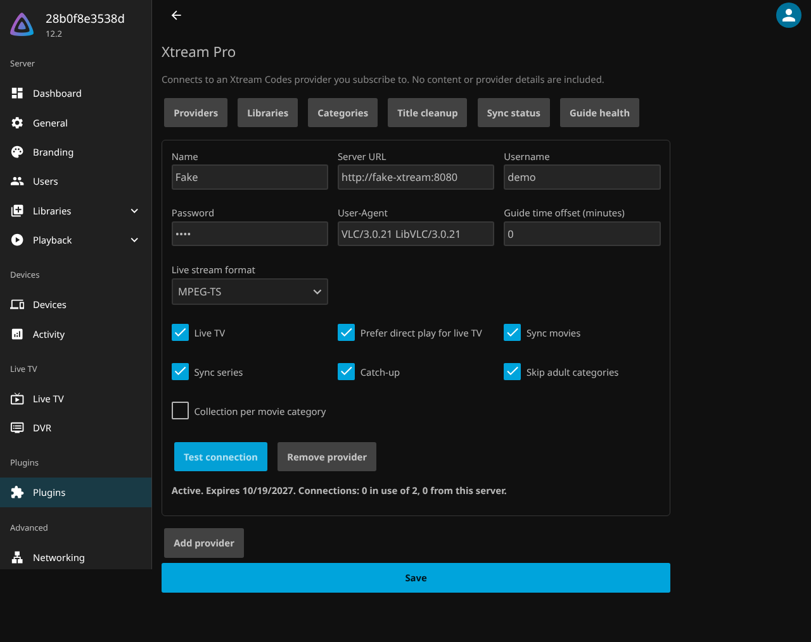
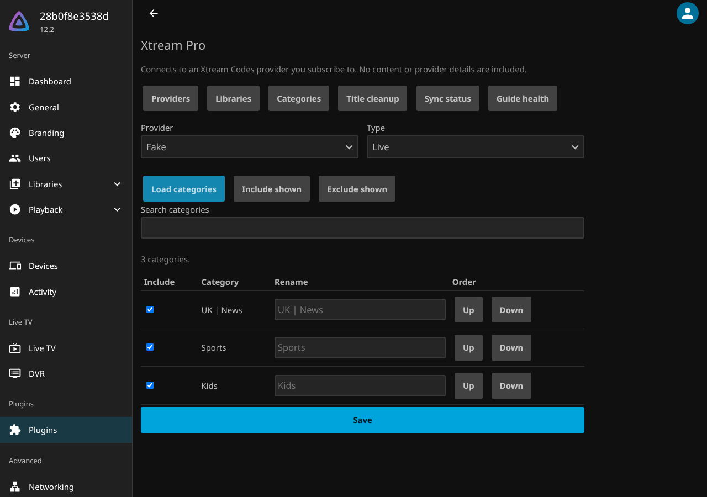
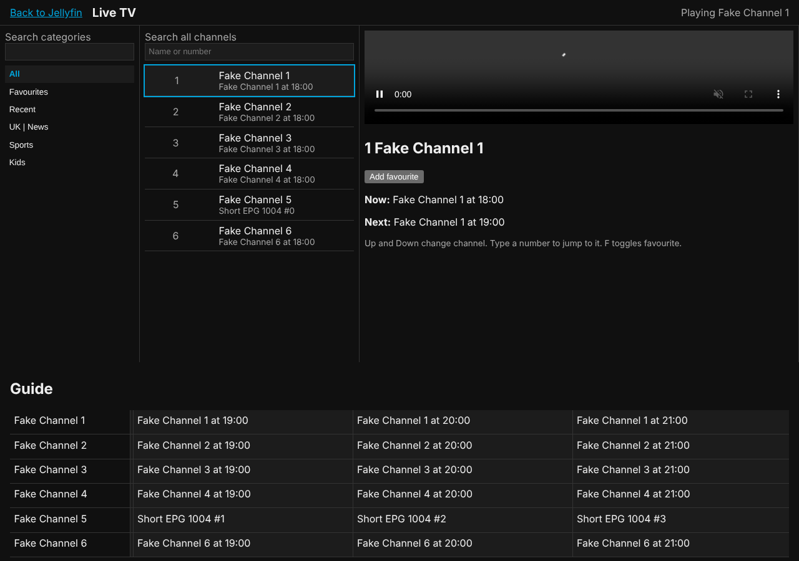

# Xtream Pro for Jellyfin

A Jellyfin plugin for Xtream Codes compatible IPTV providers. Live TV and the guide go through Jellyfin's native Live TV, and VOD and series are synced into regular Movies and Shows libraries using `.strm` and `.nfo` files, so they get posters, resume, search and collections like any other media. Catch-up programmes appear as episodes.

**You need a legitimate subscription with an Xtream Codes compatible provider.** This plugin is only a client. It ships no content, playlists or provider details.



## Install

1. In Jellyfin, open Dashboard, Plugins, Repositories and add:
   `https://ignition-consulting-group.github.io/jf_xtream_code/manifest.json`
2. Install "Xtream Pro" from the catalogue and restart Jellyfin.

Or download the zip from the [latest release](https://github.com/Ignition-Consulting-Group/jf_xtream_code/releases/latest), check it against `checksums.sha256`, and unpack it into a folder under your Jellyfin `plugins` directory.

## Setup

1. Open Dashboard, Plugins, Xtream Pro.
2. Add a provider with its URL, username and password, then use "Test connection" to check the account, expiry and connection usage.
3. Live TV channels and the guide appear on their own after the "Refresh Xtream guide" task runs (Dashboard, Scheduled Tasks).
4. For movies and series, set a movies folder and a shows folder on the Libraries tab, run "Sync Xtream movies" and "Sync Xtream series", then add each folder as a Movies or Shows library.
5. For catch-up, set a catch-up folder and add it as a Shows library. Past programmes on archive channels appear as episodes, one show per channel.
6. Use the Categories tab to hide, rename or reorder categories, and Title cleanup to strip provider prefixes such as `EN | `.
7. Optional: turn on "Enhanced Live TV page" on the Libraries tab and restart. It is at `/XtreamPro/Web/`, and with the [File Transformation](https://github.com/IAmParadox27/jellyfin-plugin-file-transformation) plugin installed it also appears as "Live TV+" in the web client menu.

`.strm` files point back at this Jellyfin server and hold no provider credentials. Set "Stream base URL" to an address your clients can reach if the server's local address is not right.





### What works where

Native apps (Android TV, Swiftfin, Roku and others) draw their own UI, so a plugin cannot change it. They still get the channels, guide, catch-up and the Movies and Shows libraries. The enhanced Live TV page works in the web client and apps that wrap it, such as Jellyfin Media Player and the mobile apps.

## Compatibility

| Plugin | Jellyfin |
|---|---|
| 1.x | 12.2 |

## Development

Requirements: .NET 10 SDK, Docker, GNU make. `make release-dry` also needs `pip install jprm`.

```sh
dotnet tool restore && dotnet husky install   # pre-commit hook: format + unit tests
make test         # unit tests
make coverage     # unit tests with the 80% coverage gate
make test-int     # integration tests, including a real Jellyfin container
make test-ui      # Playwright tests (run playwright.ps1 install chromium once)
make screenshots  # regenerate the README screenshots
make bench        # 50k item sync benchmark
make dev-up       # Jellyfin on :8096 with the plugin, FakeXtreamServer on :8080
make dev-reload   # rebuild the plugin, restart Jellyfin, tail logs
make release-dry  # build the release zip locally
```

To smoke test against a real provider, copy `.env.example` to `.env` and fill it in. `.env` is git-ignored.

Releases are cut by release-please from Conventional Commits. Merging its release PR builds the zip, attaches it and a checksum to the GitHub release, and updates `manifest.json` on the `gh-pages` branch.

Design decisions are in [docs/adr](docs/adr) and progress in [docs/PROGRESS.md](docs/PROGRESS.md).

## License

GPL-3.0, as required for plugins that link against Jellyfin.
